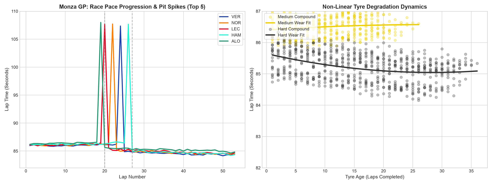
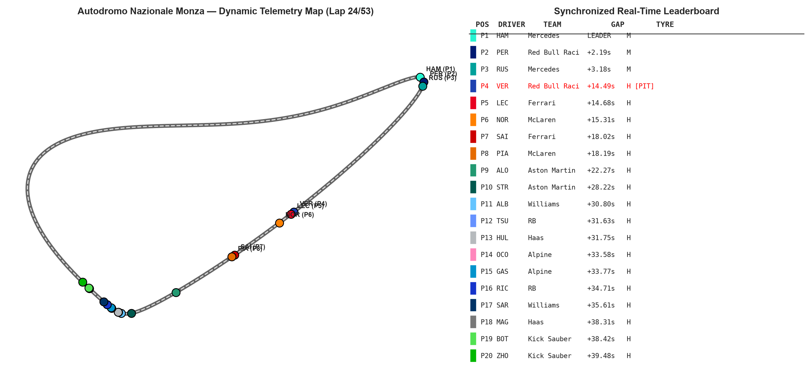
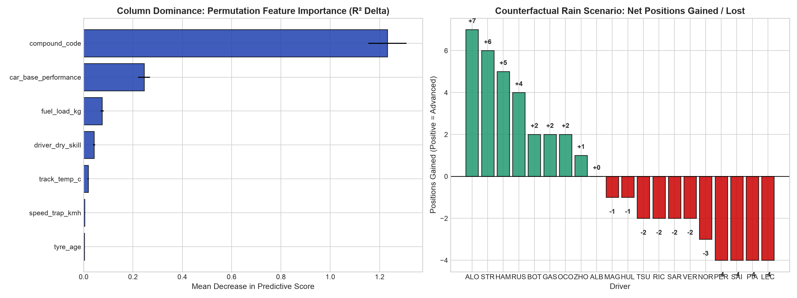

# Data Science: From Yesterday to Tomorrow 🏎️📊

[](tests/)
[](requirements.txt)
[](hands-on/f1_simulation.py)
[](LICENSE)
[](https://erolrecep.github.io/datascience_from_yesterday_to_tomorrow/)
<br/>
[](https://erolrecep.github.io/posts/data-science-yesterday-tomorrow/)
[](https://erolrecep.github.io/posts/data-science-yesterday-tomorrow-part-2/)

A structured curriculum exploring the 25-year evolution of Data Science—from early Web 2.0 clickstream telemetry in 2000 to modern Foundation Models, physics-informed synthetic simulation, and counterfactual causal reasoning.

> 🖥️ **Interactive Keynote Presentation**: [Launch the 24-Slide Reveal.js Deck &rarr;](https://erolrecep.github.io/datascience_from_yesterday_to_tomorrow/)  
> 📖 **Published Retrospective Articles**: [Part 1: Why Data Science + AI is Your Unstoppable Superpower](https://erolrecep.github.io/posts/data-science-yesterday-tomorrow/) | [Part 2: Lessons from a Quarter-Century of Hype and Reality](https://erolrecep.github.io/posts/data-science-yesterday-tomorrow-part-2/)

---

## 📂 Repository Structure

The project is structured into two core tracks: **Keynote Presentation & Articles** (published online) and **Hands-On Simulation Labs** (hosted here):

```
.
├── hands-on/                                 # Hands-On Telemetry, Animation & Machine Learning
│   ├── 01_f1_data_generation_and_visualization.ipynb # Lab 1: Deterministic generation & EDA
│   ├── 02_f1_race_animation.ipynb            # Lab 2: Dual-panel circuit & intra-lap animation
│   ├── 03_f1_predictive_modeling_and_whatif.ipynb # Lab 3: Feature dominance & rain counterfactual
│   ├── f1_simulation.py                      # Reusable physics simulation & telemetry engine
│   ├── f1_monza_race_data.csv                # 53-lap telemetry dataset (1,060 records)
│   └── f1_monza_highres_telemetry.csv        # Continuous intra-lap high-frequency telemetry
├── assets/                                   # Visual snapshots and telemetry plots
├── tests/                                    # Automated pytest verification suite (14 tests)
├── index.html                                # Instant redirect to online keynote presentation
├── Makefile                                  # Automated build, test, and execution pipeline
├── requirements.txt                          # Core dependencies
└── requirements-dev.txt                      # Development & testing dependencies
```

---

## 📑 Keynote Presentation & Retrospective Essays

The theoretical foundation and historical retrospective are published and freely accessible on the technical blog:

* 🖥️ **[Interactive Reveal.js Presentation Deck](https://erolrecep.github.io/datascience_from_yesterday_to_tomorrow/)**  
  *(24 interactive slides with KaTeX math, embedded telemetry snapshots, glassmorphism UI, keyboard navigation, and speaker notes).*
* 📄 **[Part 1: Why Data Science + AI is Your Unstoppable Superpower](https://erolrecep.github.io/posts/data-science-yesterday-tomorrow/)**  
  *A 15-year journey from commodity laptops and MapReduce to supercomputers, $30B enterprise problem, and foundation models—featuring the Parable of the Alpine Pass, clinical target leakage, and reactive computational graphs.*
* 📄 **[Part 2: Lessons from a Quarter-Century of Hype and Reality](https://erolrecep.github.io/posts/data-science-yesterday-tomorrow-part-2/)**  
  *A 25-year chronological retrospective across 5 Episodes (2000–Present), the 2012 HBR catalyst, the birth of `academic/awesome-datascience`, physics-informed synthetic telemetry, and counterfactual reasoning.*
* ⭐ **[academic/awesome-datascience](https://github.com/academic/awesome-datascience)**  
  *Curated open-source guide with over 30,300 stars and 6,700 forks.*

---

## 🏎️ Hands-On Telemetry Labs (Run Locally or in Google Colab)

Every notebook can be launched with **1-click in Google Colab** (no local environment setup required) or executed locally with the `Makefile`.

| Lab | Focus | Description | 1-Click Launch |
| :--- | :--- | :--- | :---: |
| **Lab 1** | **Data Generation & EDA** | Deterministic telemetry generator for 20 cars across 53 laps at Monza; pace progression, non-linear tyre degradation, speed traps, and bump charts. | [](https://colab.research.google.com/github/erolrecep/datascience_from_yesterday_to_tomorrow/blob/main/hands-on/01_f1_data_generation_and_visualization.ipynb) |
| **Lab 2** | **Race Animation** | Dual-panel interactive animation: Macro 53-lap full race + continuous intra-lap motion (braking to ~80 km/h in chicanes, DRS acceleration past 330 km/h). | [](https://colab.research.google.com/github/erolrecep/datascience_from_yesterday_to_tomorrow/blob/main/hands-on/02_f1_race_animation.ipynb) |
| **Lab 3** | **Predictive ML & What-If** | Random Forest lap time regression ($R^2 = 0.96$), Column Dominance analysis (MDI & Permutation), and counterfactual rain simulation (*"Who would have won in the wet?"*). | [](https://colab.research.google.com/github/erolrecep/datascience_from_yesterday_to_tomorrow/blob/main/hands-on/03_f1_predictive_modeling_and_whatif.ipynb) |

> **Self-Healing Colab Execution**: All notebooks feature automated environment detection. When opened in Google Colab, each notebook automatically verifies dependencies and fetches necessary datasets from GitHub, preventing any `FileNotFoundError`.

---

## 📸 Visual Snapshots: What You See When Running the Labs

### Lab 1: Race Telemetry & Exploratory Data Analysis
Visualizes lap time evolution, tyre compound degradation curves, straight-line speed trap correlations, and race-long position bump charts.



---

### Lab 2: Interactive 2D Circuit Tracking & Real-Time Leaderboard
Animates continuous vehicle motion around the Autodromo Nazionale Monza with authentic team liveries, live gap-to-leader telemetry, tyre compound indicators, and pit notices.



---

### Lab 3: Feature Dominance & "What-If Rain" Counterfactual
Extracts column importance (fuel weight vs. tyre age vs. car aero) and simulates a torrential rain counterfactual where aerodynamic advantages compress and raincraft masters (Lewis Hamilton & Fernando Alonso) surge to the podium.



---

## 🛠️ Local Quickstart with Makefile

Run locally with standard `make` commands:

```bash
# 1. View available commands
make help

# 2. Set up virtual environment and install dependencies (auto-detects uv for speed)
make install-dev

# 3. Generate reproducible F1 telemetry datasets (seed=42)
make data

# 4. Run automated test suite with coverage
make test-cov

# 5. Execute all Jupyter notebooks in-place
make run-notebooks

# 6. Start local JupyterLab web server
make jupyter

# 7. Open Reveal.js keynote presentation in browser
make presentation
```

---

## 🧪 Automated Verification Suite

Run tests anytime with:
```bash
make test
```

Verified test coverage includes:
* **Physics Invariants**: Position uniqueness ($1..20$ per lap), determinism, fuel monotonicity, pit deltas, and closed track geometry.
* **Predictive Accuracy**: Random Forest $R^2 \ge 0.90$, $\text{RMSE} < 0.35\text{s}$, column dominance ranking, and rain counterfactual podium verification.
* **Online Compatibility**: `nbformat: 4` compliance, SVG badge links, and self-healing cloud bootstrap detection.
